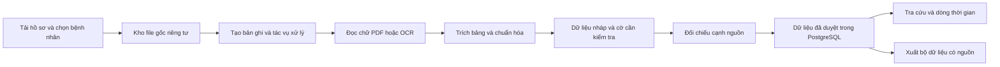

# Thiết kế kho dữ liệu lupus: công cụ, trường ưu tiên và thuật toán xử lý

> **Yêu cầu bảo mật hiện hành:** OCR và dữ liệu chạy hoàn toàn trên server nội bộ có GPU NVIDIA theo [đề xuất kỹ thuật mới](./OCR-TECHNICAL-PROPOSAL.md). Các lựa chọn Supabase cloud/Azure bên dưới là phương án cũ, không áp dụng cho triển khai hiện tại.

> **Phạm vi mới nhất 05/11/2026 theo xác nhận lại:** phần OCR tạo **pool dữ liệu theo bộ trường nghiệp vụ của Word lupus**, để hệ thống lưu trữ phía sau tiếp nhận và có thể xuất Word. Đầu ra hiện tại là dữ liệu có nguồn, trạng thái, lịch sử và phiên bản; không phải DOCX đã điền. Xem [đặc tả OCR → pool](./OCR-TO-CRF-SPEC.md), [hợp đồng bàn giao](./OCR-DATA-POOL-CONTRACT.md) và [lịch 6 tuần](./IMPLEMENTATION-TIMELINE.md). Thiết kế cơ sở dữ liệu bên dưới là tham khảo cho hệ thống phía sau; các lựa chọn cloud là phương án cũ, không áp dụng.

Ngày lập: 05/11/2026. Phạm vi: bản chạy thử trong 6 tuần, ưu tiên quản lý dữ liệu và OCR theo yêu cầu người dùng.

Tài liệu này là đề xuất thiết kế để triển khai; chưa tạo cơ sở dữ liệu, tài khoản dịch vụ hoặc xử lý hồ sơ thật. Căn cứ nghiệp vụ là [phân tích CRF](./CRF-DATA-ANALYSIS.md) và [kế hoạch 6 tuần](./IMPLEMENTATION-TIMELINE.md). Các trường lâm sàng ưu tiên cần bác sĩ rà soát khi chốt từ điển; danh sách này mô tả thông tin cần lấy từ hồ sơ có sẵn.

## 1. Quyết định đề xuất

**Chọn PostgreSQL trên Supabase làm nơi quản lý dữ liệu; Supabase Storage riêng tư giữ file; Supabase Auth quản lý đăng nhập; Supabase Queues giao việc cho tiến trình Python; Azure Document Intelligence Layout đọc ảnh/bảng.**

Giao diện web quản lý và duyệt được xây bằng Next.js/TypeScript. Tiến trình Python lấy chữ từ PDF, gọi OCR khi cần, trích xuất theo cấu trúc bảng, chuẩn hóa bằng từ điển và kiểm tra dữ liệu. Trong phạm vi đầu chưa cần mô hình ngôn ngữ để diễn giải nội dung tự do.

Lý do chọn: dùng các thành phần quản lý sẵn để dành thời gian cho cấu trúc dữ liệu, thuật toán trích bảng và màn hình duyệt. Đây là lựa chọn cơ sở cho mốc 6 tuần, chưa phải kết luận công cụ có độ chính xác cao nhất trên hồ sơ của dự án.

Điều kiện sử dụng cấu hình cloud: đơn vị quản lý xác nhận nơi lưu, nơi xử lý và điều kiện sử dụng dịch vụ với dữ liệu của mình trong tuần 1. Nếu cần xử lý nội bộ, giữ cấu trúc PostgreSQL và thay thành phần lưu file/OCR bằng dịch vụ nội bộ; cần đo lại nguồn lực và tiến độ.

## 2. Bộ công cụ và nhiệm vụ từng thành phần

| Thành phần | Công cụ chọn | Dùng để làm gì | Điểm cần triển khai thêm |
| --- | --- | --- | --- |
| Cơ sở dữ liệu | PostgreSQL do Supabase quản lý | Bệnh nhân, tài liệu, xét nghiệm, thuốc, trạng thái, nguồn và lịch sử | Thiết kế bảng, khóa liên kết, quyền truy cập và giao dịch duyệt |
| Kho file | Supabase Storage, bucket private | PDF/ảnh gốc, bản xử lý, kết quả OCR đầy đủ và file xuất | Quy tắc truy cập, đường dẫn, sao lưu file riêng |
| Đăng nhập | Supabase Auth | Tài khoản quản trị, đối chiếu, bác sĩ, chỉ xem | Phân quyền theo dữ liệu; không mặc định có tài khoản là xem được mọi hồ sơ |
| Hàng đợi | Supabase Queues | Tác vụ OCR/trích xuất, xử lý lại khi lỗi | Worker Python, giới hạn thử lại, chống tạo kết quả trùng |
| PDF có chữ | pdfplumber | Lấy chữ, tọa độ và bảng có sẵn | Kiểm tra chất lượng đầu ra; chuyển OCR khi chữ/bảng không dùng được |
| Ảnh/PDF scan | Azure Document Intelligence, model prebuilt-layout, API 2024-11-30 GA | Chữ, ô bảng, cấu trúc trang và vị trí | Chuyển cấu trúc bảng thành dữ liệu xét nghiệm; đối chiếu chất lượng trên mẫu thật |
| Chuẩn hóa và kiểm tra | Python, Pydantic, Decimal, RapidFuzz; OpenCV khi cần | Kiểm tra kiểu, xử lý số, gợi ý tên, tiền xử lý ảnh | Quy tắc theo từ điển và bộ kiểm tra của dự án |
| Giao diện | Next.js/TypeScript | Kho hồ sơ, tiến độ xử lý, màn hình duyệt và bảng dữ liệu | Phải xây giao diện phù hợp nghiệp vụ; bảng quản trị dịch vụ không thay màn hình duyệt |

PostgreSQL có JSONB và khả năng đánh chỉ mục; đề xuất dùng cột quan hệ cho trường truy vấn chính, JSONB cho bản nháp và thông tin mở rộng. File OCR JSON nguyên bản được giữ riêng để bảo toàn đầu ra, vì JSONB không bảo toàn mọi chi tiết trình bày JSON. [S1]

Supabase Storage hỗ trợ bucket riêng tư, kiểm soát bằng RLS và URL có hạn dùng. Thiết kế quyền phải áp dụng cho cả dữ liệu và file. Hàng đợi lưu bền vững trong PostgreSQL giúp phục hồi công việc; worker vẫn phải chống xử lý trùng khi tác vụ được giao lại. [S2, S3, S4]

Layout cung cấp chữ và cấu trúc bảng; tiếng Việt in nằm trong danh sách hỗ trợ. Dịch vụ này chưa tự ánh xạ một dòng thành xét nghiệm đúng ngữ nghĩa của registry; cần bước trích xuất, từ điển và đối chiếu riêng. pdfplumber phù hợp trước hết với PDF có chữ, không thay thế OCR cho ảnh scan. [S5, S6, S7]

### 2.1 So sánh lựa chọn thực tế

| Lựa chọn | Khi phù hợp | Quyết định cho đợt đầu |
| --- | --- | --- |
| Supabase PostgreSQL + Storage + Auth + Queues | Nhóm nhỏ, cần nhanh có dữ liệu và quyền truy cập trên cùng nền tảng | Chọn làm cấu hình cơ sở, sau khi chốt nơi lưu và điều kiện dịch vụ |
| PostgreSQL + kho file + đăng nhập tự vận hành | Đơn vị có hạ tầng và người vận hành, hoặc cần lưu nội bộ | Phương án thay thế; tính thêm công việc triển khai, cập nhật, sao lưu |
| Azure Layout | Cần OCR cả chữ và bảng, ưu tiên tích hợp nhanh | Công cụ OCR đề xuất; thử trên 20–30 tài liệu trước khi khóa lựa chọn |
| PaddleOCR triển khai nội bộ | Cần chủ động nơi chạy OCR và có nguồn lực vận hành | Phương án đối chứng/thay thế; hỗ trợ tiếng Việt không đồng nghĩa đọc bảng xét nghiệm đã đạt yêu cầu [S8] |
| PDF có chữ qua pdfplumber | File điện tử đọc được chữ và giữ cấu trúc tốt | Dùng trước để giảm số trang gọi dịch vụ OCR; kiểm tra từng trang |
| Excel/CSV | Trao đổi, kiểm tra và xuất bộ dữ liệu | Dùng ở đầu ra; dữ liệu có thẩm quyền và lịch sử được quản lý trong PostgreSQL |

Không huấn luyện OCR riêng trong 6 tuần. Chi phí được dự toán theo số trang OCR thực tế, lần thử lại, lưu trữ, truyền dữ liệu và thời gian đối chiếu; lấy đơn giá nhà cung cấp tại thời điểm chốt, chưa đưa con số ngân sách khi chưa biết khối lượng.

## 3. Cấu trúc kho dữ liệu

### 3.1 Luồng tổng thể



Giữ riêng ba lớp: **file gốc → đầu ra OCR/bản nháp → dữ liệu đã đối chiếu**. Dữ liệu đã duyệt là nguồn cho tra cứu có xác minh và bộ xuất mặc định. Lịch sử sửa, các giá trị chưa rõ và bản OCR cũ vẫn được giữ theo chính sách lưu trữ.

### 3.2 Các bảng hoặc nhóm bảng tối thiểu

Tên dưới đây là tên kỹ thuật đề xuất, có thể điều chỉnh khi triển khai.

| Nhóm | Nội dung | Quan hệ quan trọng |
| --- | --- | --- |
| patients, patient_private | Mã registry và thông tin định danh có quyền riêng | Một người có nhiều hồ sơ, xét nghiệm và giai đoạn thuốc |
| patient_identifiers | Mã bệnh viện/nghiên cứu kèm nơi cấp | Không coi mã giống nhau ở hai cơ sở là cùng người |
| consent_records | Phạm vi, phiên bản, ngày và trạng thái đồng ý/căn cứ tiếp nhận theo quy trình đơn vị | Gắn với bệnh nhân và tài liệu bằng chứng nếu có |
| submissions, documents | Lô gửi và tài liệu; vị trí file; loại; nguồn; hash; tình trạng bệnh nhân | Một lô nhiều file; một file nhiều trang |
| processing_runs, ocr_pages | Lần xử lý, phiên bản công cụ, chữ/bảng/tọa độ, lỗi và chi phí | Một tài liệu có nhiều lần xử lý; mỗi lần có nhiều trang |
| extraction_candidates | Bản nháp theo loại kết quả, nội dung gốc, gợi ý chuẩn hóa và cờ | Mỗi bản nháp gắn lần xử lý và bằng chứng |
| encounters | Lần khám/sự kiện, cơ sở và thời gian | Có thể liên kết nhiều tài liệu; thiếu căn cứ thì chưa tạo liên kết chắc chắn |
| observations | Xét nghiệm/phép đo theo thời gian | Một hàng cho một kết quả của một lần làm; không chỉ giữ số mới nhất |
| medication_records | Đơn thuốc và giai đoạn dùng thuốc được ghi nhận | Tách kê đơn, dự kiến điều trị và tự khai thực dùng |
| concept_dictionary, concept_aliases | Tên chuẩn, tên nguồn, mẫu/đơn vị/phương pháp phân biệt, phiên bản | Một tên nguồn có thể cần ngữ cảnh để xác định khái niệm |
| evidence_links | Nguồn, trang/vùng, đoạn chữ, vai trò nguồn chính/phụ | Một kết quả có nhiều bằng chứng; một tài liệu chứa nhiều kết quả |
| review_events, record_revisions, audit_events | Duyệt, sửa, phiên bản, truy cập/xuất | Ghi trước/sau sửa, người, thời gian và lý do |
| exports | Tiêu chí chọn, thời điểm, danh sách phiên bản bản ghi và đường dẫn file xuất | Có thể tái lập bộ dữ liệu đã bàn giao |

### 3.3 Cách lưu file

Đường dẫn đề xuất, chỉ dùng mã nội bộ:

```text
originals/{project_id}/{document_id}/source.pdf
derived/{project_id}/{document_id}/{run_id}/page-001.png
ocr/{project_id}/{document_id}/{run_id}/response.json
exports/{project_id}/{export_id}/observations.csv
```

Không đưa tên bệnh nhân vào đường dẫn. Cơ sở dữ liệu giữ khóa file; URL tải có hạn được tạo khi người có quyền mở tài liệu. Trạng thái tải hoàn tất, ghi nhận tài liệu và gửi tác vụ phải được đối soát để xử lý file tải dở hoặc tác vụ chưa tạo.

Tạo chỉ mục ban đầu theo mã bệnh nhân, tài liệu, trạng thái xử lý, ngày liên quan, tên chuẩn xét nghiệm và nguồn. Bổ sung theo truy vấn thực tế; JSONB phục vụ mở rộng, còn trường dùng thường xuyên có cột/quan hệ rõ ràng.

### 3.4 Ràng buộc cần có trong cơ sở dữ liệu

- Mã registry duy nhất trong dự án; mọi liên kết bệnh nhân/tài liệu/bản ghi phải cùng phạm vi dự án được phép truy cập.
- Khóa ngoại bảo đảm tài liệu, lần xử lý, bằng chứng và người duyệt tồn tại; không xóa dây chuyền làm mất nguồn của dữ liệu đã công bố.
- Bản ghi có trạng thái đã đối chiếu phải có người/thời điểm duyệt và định danh bệnh nhân đã xác nhận; thiếu nội dung nguồn được giữ bằng trạng thái thiếu tương ứng.
- Một khóa tác vụ không được tạo hai bộ kết quả chính thức; việc giao lại công việc vẫn có thể xảy ra và được kiểm soát bằng khóa/phiên bản.
- Giao dịch duyệt ghi bản sửa, lịch sử và trạng thái nhất quán; kiểm tra phiên bản để phát hiện chỉnh sửa đồng thời.
- Sửa gán bệnh nhân của tài liệu phải rà soát các kết quả phụ thuộc, ghi lịch sử và xử lý lại bộ xuất bị ảnh hưởng theo quy trình; không chỉ đổi mã ở một bảng.

## 4. Chọn các trường quan trọng

### 4.1 Quy ước ưu tiên và bắt buộc

- **P0 — vận hành:** hệ thống phải có để quản lý bản ghi và nguồn; phần lớn tự tạo.
- **P1 — nội dung ưu tiên:** hệ thống chủ động tìm và trích khi có trong hồ sơ. Thiếu được lưu trạng thái; không bắt bệnh nhân phải có đủ xét nghiệm.
- **P2 — mở rộng:** vẫn giữ tài liệu gốc, bổ sung trích xuất có cấu trúc ở đợt sau.

Mỗi trường có thể có giá trị cùng trạng thái: có dữ liệu, không được ghi, không đọc được, mâu thuẫn hoặc chưa ánh xạ. Không biến mọi ô trống thành âm tính. Các mã CRF bên dưới là mã đề xuất trong bản phân tích hiện có, không phải mã chuẩn quốc tế.

### 4.2 Bệnh nhân và nguồn: P0

| Trường đề xuất | Ý nghĩa | Quy tắc |
| --- | --- | --- |
| patient_id | Khóa bệnh nhân nội bộ | Hệ thống tạo; bắt buộc khi duyệt vào hồ sơ |
| registry_code | Mã dễ dùng trong registry | Duy nhất trong dự án; không tái sử dụng |
| source_identifiers | Mã bệnh viện/nghiên cứu và cơ sở cấp | Thu khi có; đối chiếu kèm nơi cấp |
| identity_status | Chưa xác nhận/đã xác nhận/có mâu thuẫn | Bắt buộc; OCR chỉ gợi ý |
| full_name_raw | Tên theo nguồn | Lưu ở vùng định danh có quyền riêng; giữ bản gốc khi có |
| birth_date hoặc age_at_event | Ngày sinh có căn cứ hoặc tuổi tại mốc | Có độ chính xác và nguồn; không tạo ngày sinh từ tuổi |
| sex_raw | Nhãn giới/giới tính theo hồ sơ | Thu khi có; theo định nghĩa từ điển, không dùng một mình để ghép người |
| consent_or_intake_status | Tình trạng tiếp nhận/sử dụng dữ liệu theo quy trình | Ghi phạm vi, phiên bản và bằng chứng khi áp dụng; không mặc định đồng ý |
| document_id, submission_id | Mã tài liệu và lô gửi | Tự tạo |
| storage_key, file_hash, mime_type | Vị trí, SHA-256 và loại file | Tự ghi; kiểm tra nội dung file |
| document_type | Xét nghiệm/đơn thuốc/giấy khám/khác/chưa rõ | Phân loại máy là gợi ý, sửa được |
| issuing_facility, performing_lab | Nơi phát hành và nơi làm xét nghiệm | Giữ riêng, thu khi nguồn có |
| document_date, uploaded_at | Ngày hồ sơ và thời điểm tải | Không thay ngày lâm sàng bằng ngày tải |
| processing_status, created_by | Tiến độ xử lý và người gửi | Bắt buộc |
| record_version, created_at, updated_at | Phiên bản và thời gian hệ thống | Tự tạo; cập nhật có nhật ký |

Số điện thoại, địa chỉ chi tiết và giấy tờ định danh chỉ thêm khi quy trình tiếp nhận thực sự cần; xác định quyền riêng. Không dùng chúng làm cột mặc định trong bộ xuất phân tích.

### 4.3 Một kết quả xét nghiệm: cấu trúc cần có ngay

Các dòng bảng dưới là nhóm thuộc tính; khi triển khai sẽ tách thành cột hoặc quan hệ phù hợp.

| Trường/nhóm trường | Mức | Cách xử lý |
| --- | --- | --- |
| observation_id, patient_id | P0 | Mã bản ghi và người đã xác nhận khi duyệt |
| document_id, run_id, evidence_links | P0 | Tài liệu, lần trích xuất, trang/vùng hoặc đoạn bằng chứng |
| test_name_raw | P1 | Giữ đúng tên trên phiếu |
| concept_id, dictionary_version | P1 | Tên/mã chuẩn nội bộ và phiên bản; chưa rõ thì chưa ánh xạ |
| result_raw, result_type | P1 | Nguyên văn; loại số, định tính, hiệu giá, khoảng hoặc văn bản |
| numeric_value, comparator | P1 | Số dùng Decimal/numeric; dấu <, ≤, >, ≥, = được giữ riêng |
| text_value, qualitative_value | P1 | Giữ âm/dương, ranh giới, ký hiệu/cường độ theo nguồn |
| unit_raw, unit_normalized | P1 | Đơn vị gốc và nhãn chuẩn; thiếu thì đánh dấu |
| reference_raw, reference_low, reference_high | P1 | Khoảng/mô tả tham chiếu của phiếu; chỉ tách số khi đủ rõ |
| abnormal_flag_source | P1 | Cờ H/L hoặc nhận xét do nguồn ghi; không tự đặt ngưỡng y khoa |
| specimen, method, panel_id | P1 | Loại mẫu, phương pháp và lần làm panel nếu có; ảnh hưởng ánh xạ/so sánh |
| collected_at, reported_at | P1 | Ngày lấy mẫu và trả kết quả; giữ riêng |
| event_time_raw, event_time_role, date_precision | P1 | Bản ngày gốc, loại ngày, biết ngày/tháng/năm đến đâu |
| encounter_id, accession_number | P1 | Lần khám và mã mẫu/lần xét nghiệm nếu xác định được |
| normalized_value, conversion_rule_id | P1 có điều kiện | Chỉ có khi đủ căn cứ chuyển đổi; luôn giữ giá trị gốc |
| missing_fields, validation_flags | P0 | Các thuộc tính thiếu và vấn đề cần kiểm tra |
| review_status, reviewed_by, reviewed_at | P0 | Trạng thái; người/thời điểm bắt buộc nếu đã đối chiếu |
| revision_id, supersedes_id | P0 khi có sửa | Liên kết phiên bản và bản bị thay thế |

Kết quả thiếu ngày hoặc đơn vị vẫn có thể được lưu và đối chiếu đúng với nguồn, nhưng phải giữ trạng thái thiếu; truy vấn phân tích cần ngày/đơn vị sẽ lọc riêng. Kết quả chưa ánh xạ vẫn truy cập được từ hồ sơ, không tự đưa vào nhóm xét nghiệm chuẩn. Không chuyển “không đọc được” thành một số để hoàn thành biểu mẫu.

### 4.4 Nhóm xét nghiệm ưu tiên lấy từ CRF

| Nhóm | Nội dung chọn trước | Mã trong bản phân tích CRF | Quy tắc phân biệt |
| --- | --- | --- | --- |
| Huyết học | RBC, Hb, WBC, PLT | HEM01, HEM02, HEM05, HEM11 | RBC máu khác RBC niệu; giữ đơn vị |
| Công thức bạch cầu | NE, LY | HEM06, HEM07 | Tách số tuyệt đối với tỷ lệ % |
| Chức năng thận | Urea, creatinine, eGFR được ghi | REN04–REN06 | Urea khác BUN; creatinine máu/niệu riêng; không tự tính eGFR trong đợt đầu |
| Protein và mẫu niệu | Albumin, UPCR, protein niệu 24 giờ | REN09, REN01, REN08 | Albumin máu/niệu riêng; UPCR khác tổng lượng protein 24 giờ |
| Tế bào niệu | Hồng cầu niệu, bạch cầu niệu | REN02–REN03 | Giữ cách đếm, đơn vị và loại mẫu theo nguồn |
| Bổ thể | C3, C4 | IMM11–IMM12 | Giữ đơn vị và khoảng tham chiếu mỗi lần |
| Kháng thể | ANA; anti-dsDNA | IMM01, IMM04; ANA01 khi thuộc panel | ANA có định tính/hiệu giá/pattern; dsDNA giữ phương pháp/panel, không gộp mọi phép thử |
| Men gan | AST, ALT | GI01–GI02 | Ánh xạ GOT/GPT theo từ điển đã rà soát |
| Dấu ấn được ghi | CRP, ESR | IMM19–IMM20 | Giữ đơn vị và phương pháp khi có |

Lý do chọn: các nhóm này đã có trong CRF và cho phép kiểm tra đủ dạng dữ liệu: số, đơn vị, tỷ số, định tính, hiệu giá và kết quả lặp. Thứ tự trích xuất thực tế tiếp tục dựa vào tần suất xuất hiện trong mẫu được cung cấp. Bác sĩ chốt mức ưu tiên chuyên môn; đây không phải danh sách xét nghiệm phải chỉ định.

P2: panel kháng thể đầy đủ, sinh thiết chi tiết, PFT, thăm dò hình ảnh, các nhóm cơ quan và thành phần thang điểm. Trường ngoài danh mục vẫn giữ nguyên trong nguồn/bản OCR.

### 4.5 Thuốc và lần khám

| Nhóm | Trường ưu tiên | Quy tắc |
| --- | --- | --- |
| Thuốc | medication_id, patient_id, tên nguyên văn, tên chuẩn nếu chắc chắn | Gắn nguồn và phiên bản từ điển; nguồn CRF TRT02–TRT03 |
| Hàm lượng | strength_raw, giá trị/đơn vị, dạng bào chế | Hàm lượng viên không đồng nghĩa liều mỗi lần |
| Cách dùng | dose_raw, dose_value/unit, frequency_raw, route_raw | Chỉ cấu trúc khi rõ; giữ nguyên chuỗi lịch dùng phức tạp; TRT04–TRT06 |
| Thời gian dùng | prescribed_at, start/end, date_precision | Không tự kết luận ngừng thuốc khi thiếu đơn mới; TRT07–TRT09 |
| Loại thông tin thuốc | prescribed/planned/self_reported/unknown | Tách thuốc được kê với thực tế bệnh nhân nói đang dùng |
| Lần khám | encounter_id, patient_id, ngày/độ chính xác, cơ sở, loại lần khám | Không tự tạo một lần khám mới chỉ từ ngày tải |
| Chẩn đoán theo nguồn | diagnosis_raw, coding_system/code nếu ghi, ngày và mức xác nhận | Không suy chẩn đoán từ một kết quả xét nghiệm |
| Điểm bệnh đã ghi | score_name/version nếu có, score_raw, assessed_at, nguồn | Lưu SLEDAI/EULAR-ACR như thông tin có nguồn; tự tính ở đợt sau |

Các trường thuốc/lần khám dùng chung bằng chứng, trạng thái và lịch sử như xét nghiệm. Trong 6 tuần ưu tiên đọc tốt xét nghiệm; phần cách dùng thuốc khó được đánh dấu để đối chiếu.

## 5. Các thuật toán xử lý

### A1. Tiếp nhận và phát hiện file trùng

**Đầu vào:** file và bệnh nhân người gửi chọn.

**Cách xử lý:** kiểm tra loại nội dung thật, dung lượng, file mở được/số trang; tính SHA-256 từ toàn bộ byte; tra trong phạm vi dự án và quyền truy cập. Trùng file cùng hồ sơ thì liên kết lần gửi mới với tài liệu đã có hoặc báo trùng, không gọi OCR lại nếu kết quả tương ứng đã dùng được.

**Đầu ra:** tài liệu hợp lệ hoặc lỗi rõ ràng; hash; bản ghi lô gửi.

**Ngoại lệ:** hash giống nhưng gán bệnh nhân khác → giữ chờ xác minh; không tự đổi người. File khác byte chỉ được coi là ứng viên trùng khi có thêm bằng chứng, không tự bỏ.

### A2. Phân luồng theo trang: lấy chữ hay OCR

**Đầu vào:** PDF hoặc ảnh đã kiểm tra.

**Cách xử lý:** với PDF, thử lấy chữ/tọa độ/bảng bằng pdfplumber từng trang; kiểm tra ký tự lỗi, khả năng đọc số, tiêu đề và cấu trúc bảng. Trang có chữ nhưng hỏng bố cục hoặc thiếu nội dung vẫn chuyển sang OCR. Ảnh và trang scan dùng Layout. Chỉ OCR các trang cần thiết nếu việc tách trang giữ được ngữ cảnh, và lưu số trang gốc.

**Đầu ra:** chữ/ô bảng chuẩn hóa về cùng định dạng trung gian; mỗi trang có extraction_method.

**Ngoại lệ:** PDF lẫn chữ/ảnh xử lý theo trang; không chỉ dựa vào việc “có một ít chữ” để bỏ OCR cả file.

### A3. Kiểm tra và cải thiện ảnh có chọn lọc

**Đầu vào:** ảnh hoặc trang scan.

**Cách xử lý:** kiểm tra kích thước, chiều xoay, vùng bị cắt và độ mờ; thử sửa xoay/nghiêng khi có bằng chứng hình học. OpenCV hỗ trợ thử Otsu hoặc adaptive threshold với ảnh nền không đều. Chỉ giữ biến thể nếu bộ mẫu cho thấy có lợi; luôn bảo toàn bản gốc. Ngưỡng mờ/nghiêng được hiệu chỉnh theo mẫu, chưa đặt một ngưỡng dùng cho mọi máy ảnh. [S9]

**Đầu ra:** ảnh gốc, biến thể xử lý nếu có, phép biến đổi và cờ chất lượng.

**Ngoại lệ:** nhị phân hóa có thể làm mất dấu thập phân, chữ nhỏ hoặc đường bảng; không áp dụng hàng loạt mặc định. Không dùng suy tạo để bổ sung con số không nhìn thấy. Nếu thay đổi hình học, lưu phép biến đổi để ánh xạ tọa độ về trang gốc.

### A4. OCR và dựng cấu trúc bảng

**Đầu vào:** trang cần OCR.

**Cách xử lý:** gọi prebuilt-layout; lưu response nguyên bản, chữ, trang, bảng, hàng/cột, vùng tọa độ và điểm tin cậy khi có. Dùng chỉ số ô của mô hình làm cơ sở; nhận diện hàng tiêu đề, ô gộp và nhóm cột. Xác định cột tên xét nghiệm, kết quả, đơn vị, tham chiếu theo tiêu đề và mẫu đã kiểm chứng.

**Đầu ra:** cấu trúc bảng trung gian có liên kết ô → trang/vùng.

**Ngoại lệ:** chỉ ghép dòng tên bị xuống hàng khi bằng chứng bố cục phù hợp. Bảng qua trang chỉ nối khi thống nhất tiêu đề/cấu trúc và ngữ cảnh bệnh nhân. Nếu không chắc, giữ tách và gắn cờ; không chọn con số gần tên nhất làm kết quả.

### A5. Nhận diện loại tài liệu và tách dòng thông tin

**Đầu vào:** chữ và cấu trúc bảng.

**Cách xử lý:** kết hợp từ khóa tiêu đề, cột và cấu trúc: xét nghiệm thường có tên/kết quả/đơn vị; đơn thuốc có tên thuốc/cách dùng; giấy khám có thông tin lần khám/chẩn đoán. Ghi nhãn “hỗn hợp/chưa rõ” khi nhiều loại xuất hiện. Parser riêng của 2–3 nhóm bố cục ưu tiên chuyển từng dòng sang schema xét nghiệm hoặc thuốc.

**Đầu ra:** bản nháp dữ liệu kèm bằng chứng; giữ dòng chưa phân loại được.

**Ngoại lệ:** tài liệu nhiều bệnh nhân hoặc định danh mâu thuẫn được giữ chờ xác minh/tách tài liệu trước khi công bố. Giấy tóm tắt điều trị có nhắc tên xét nghiệm không mặc nhiên là phiếu trả kết quả.

### A6. Đối chiếu bệnh nhân

**Đầu vào:** bệnh nhân người gửi chọn và định danh đọc từ nguồn.

**Cách xử lý:** ưu tiên mã bệnh viện cùng cơ sở cấp đã biết; kiểm tra bổ sung tên/ngày sinh/tuổi nếu có. Chuẩn hóa khoảng trắng, Unicode và chữ hoa/thường để so sánh; giữ nguyên bản nguồn. Mâu thuẫn mã hoặc thông tin chính tạo cờ chặn duyệt vào hồ sơ cho đến khi người có quyền xác nhận.

**Đầu ra:** gợi ý phù hợp, chưa đủ dữ kiện hoặc có mâu thuẫn, kèm lý do.

**Ngoại lệ:** trùng tên, mất dấu, tuổi thay đổi theo năm, tên OCR sai hoặc thiếu mã không đủ để tự ghép người. Không tự gộp bệnh nhân bằng so khớp gần đúng.

### A7. Chuẩn hóa tên xét nghiệm và thuốc

**Đầu vào:** tên nguồn cùng đơn vị, loại mẫu, panel, phương pháp và nguồn phát hành.

**Cách xử lý:** chuẩn hóa Unicode/khoảng trắng nhưng giữ ký hiệu có ý nghĩa; tìm alias khớp chính xác trong từ điển có phiên bản. Chỉ ánh xạ chắc chắn khi các điều kiện ngữ cảnh phân biệt đã đủ. Nếu không khớp, RapidFuzz xếp tối đa vài ứng viên theo độ giống tên sau lọc ngữ cảnh; đưa cho người duyệt. Điểm giống chuỗi không phải xác suất đúng ngữ nghĩa. [S10]

**Đầu ra:** concept_id cùng mapping_rule/version hoặc trạng thái chưa ánh xạ và danh sách gợi ý.

**Ngoại lệ:** RBC máu/niệu, creatinine máu/niệu, NE%/NE tuyệt đối, anti-dsDNA theo phương pháp/panel phải giữ riêng. Không tự sửa tên kháng thể chưa rõ theo từ gần nhất.

### A8. Đọc giá trị, đơn vị và khoảng tham chiếu

**Đầu vào:** ô kết quả, ô đơn vị và ô tham chiếu tách riêng.

**Cách xử lý:** dùng mẫu cú pháp để phân loại số có dấu so sánh, số khoa học, khoảng, âm/dương, hiệu giá hoặc văn bản. Tách dấu <, >, ≤, ≥ khỏi giá trị số. Dùng Decimal trong Python và numeric trong PostgreSQL; giữ chuỗi gốc để không mất dấu/cách trình bày. [S11]

Chuẩn hóa dấu phẩy/chấm theo cấu hình nguồn đã kiểm chứng; nếu “1.234” có nhiều cách hiểu thì gắn cờ. Hiệu giá như 1:160 được lưu theo loại hiệu giá, không chia thành số thập phân. Khoảng tham chiếu được parse riêng để tránh lấy cận tham chiếu làm kết quả.

**Đầu ra:** giá trị có kiểu; đơn vị gốc/chuẩn; tham chiếu và cờ.

**Ngoại lệ:** không sửa O thành 0 hoặc I thành 1 trên toàn văn bản. Nghi OCR nhầm số thì quay về vùng ảnh. Không chuyển đơn vị khi thiếu loại mẫu/khái niệm hoặc quy tắc; giá trị đã chuyển luôn có conversion_rule_id và giữ nguyên bản gốc.

### A9. Xác định thời gian

**Đầu vào:** mọi chuỗi ngày cùng nhãn và vị trí nguồn.

**Cách xử lý:** tìm nhãn “ngày lấy mẫu”, “ngày trả”, “ngày khám”, “ngày kê”; tách ngày theo từng vai trò. Phân tích định dạng ngày bằng cấu hình nguồn; giữ giá trị nguyên văn và độ chính xác ngày/tháng/năm. Ngày tháng có nhiều cách hiểu và không có quy ước đáng tin được đưa chờ đối chiếu.

**Đầu ra:** các trường thời gian riêng, nguồn và date_precision.

**Ngoại lệ:** không dùng ngày tải làm ngày xét nghiệm; không suy ngày lấy mẫu từ ngày trả. Thời điểm có giờ/múi giờ được lưu kèm quy ước; ngày chỉ có lịch giữ kiểu date, không ép sang UTC làm đổi ngày.

### A10. Kiểm tra schema và tính nhất quán

**Đầu vào:** bản nháp đã parse.

**Cách xử lý:** Pydantic với kiểu và validator tường minh kiểm tra cấu trúc; kiểm tra một giá trị có phù hợp result_type, đơn vị có tương thích khái niệm, nguồn tồn tại và bệnh nhân đã xác nhận chưa. Kiểm tra ngày bất hợp lý theo quy tắc đã chốt. Quy tắc kiểm tra không được lặng lẽ ép kiểu hoặc tạo dữ liệu mới. [S12]

**Đầu ra:** bản nháp hợp cấu trúc kèm validation_flags, hoặc lỗi cần sửa.

**Ngoại lệ:** bất thường chuyên môn không đồng nghĩa lỗi OCR. Chỉ gắn cờ để xem lại khi cần; không tự xóa hay thay kết quả vì khác khoảng tham chiếu.

### A11. Phát hiện kết quả nhắc lại và mâu thuẫn

**Đầu vào:** bản nháp mới và kết quả đã có của cùng bệnh nhân.

**Cách xử lý:** tìm ứng viên theo khái niệm, ngày/lần lấy mẫu, cơ sở và mã mẫu nếu có; so thêm loại mẫu, phương pháp, giá trị và đơn vị. Trùng mã lần xét nghiệm cùng nguồn là bằng chứng mạnh nhưng vẫn cần kiểm tra tài liệu sửa kết quả. Tài liệu tóm tắt có thể là nguồn dẫn lại của một kết quả đã có.

**Đầu ra:** đề xuất “nguồn bổ sung”, “kết quả khác”, “bản hiệu chỉnh” hoặc “chưa đủ căn cứ”.

**Ngoại lệ:** cùng tên/ngày/giá trị vẫn có thể là hai lần xét nghiệm. Khác phương pháp/loại mẫu giữ riêng. Không tự lấy giá trị tải sau làm đúng hơn; người duyệt quyết định và lưu lý do.

### A12. Xếp thứ tự đối chiếu và duyệt

**Đầu vào:** cờ lỗi, tình trạng định danh, mức đọc được, thiếu dữ kiện và mâu thuẫn.

**Cách xử lý:** dùng thứ tự quy tắc dễ kiểm tra:

1. Mâu thuẫn bệnh nhân/quyền truy cập → giữ chờ xử lý, chặn công bố.
2. Giá trị hoặc dấu/đơn vị chưa rõ; nguồn mâu thuẫn; thuốc/liều chưa rõ → ưu tiên đối chiếu.
3. Thiếu ngày, chưa ánh xạ, chất lượng ảnh thấp → hàng cần làm rõ.
4. Trường đủ dữ kiện, không có cờ → hàng đối chiếu thông thường.

Người duyệt mở nguồn, xác nhận từng trường hoặc tài liệu sau khi đã kiểm tra; trường chưa rõ giữ trạng thái riêng. Giao dịch duyệt ghi phiên bản, người/thời gian và kiểm tra row_version để tránh hai người ghi đè nhau.

**Đầu ra:** dữ liệu đã đối chiếu, bản sửa có lịch sử, hoặc yêu cầu bổ sung.

**Ngoại lệ:** điểm tin cậy OCR chỉ hỗ trợ ưu tiên; chưa dùng ngưỡng đó để tự công bố trong đợt 6 tuần.

## 6. Một ví dụ đầu cuối

**Dữ liệu giả lập để minh họa, không phải hồ sơ thật.**

Phiếu có dòng: “Hb | 11,2 | g/dL | 12–16”, nhãn “Ngày lấy mẫu: 04/11/2026”, cùng mã bệnh nhân/cơ sở đã được đối chiếu.

1. File được lưu với document_id; tính hash; tạo tác vụ.
2. Đọc bảng đúng cột, giữ tọa độ dòng và trang.
3. Alias Hb ánh xạ khái niệm hemoglobin theo từ điển.
4. Lưu result_raw = “11,2”; numeric_value = 11.2; unit_raw = “g/dL”; reference_raw = “12–16”.
5. Lưu collected_at = 2026-11-04 theo định dạng nguồn đã xác định; reported_at để thiếu nếu không có.
6. Không tự chuyển đơn vị hay tự chẩn đoán; cờ bất thường của nguồn chỉ lưu khi nguồn ghi.
7. Màn hình mở đúng vùng ảnh; người đối chiếu xác nhận; bản ghi mang trạng thái đã đối chiếu và lưu người/thời điểm.
8. CSV xuất mã registry, xét nghiệm, giá trị, đơn vị, ngày lấy mẫu, nguồn, trạng thái và phiên bản.

Nếu thiếu “g/dL”, hệ thống giữ thiếu đơn vị và yêu cầu kiểm tra; không điền dựa vào tên Hb. Nếu đọc nhầm cột tham chiếu thành giá trị, lỗi phải được phát hiện khi đối chiếu và có mẫu kiểm tra để tránh lặp lại.

## 7. Đánh giá để chọn công cụ và kiểm chứng thuật toán

### 7.1 Bộ mẫu cần có

- Mẫu phát triển 20–30 tài liệu ban đầu, bổ sung trong đợt; đa dạng PDF có chữ, scan, ảnh điện thoại và bảng qua trang.
- Giữ riêng 30–50 tài liệu cuối kỳ; khi có nhiều bản cùng hồ sơ/bệnh nhân, gom cùng nhóm để giảm rò rỉ giữa phát triển và đánh giá. Đa dạng nguồn/bố cục trong giới hạn dữ liệu có được.
- Phải có tình huống dấu phẩy/chấm, dấu <, định tính, hiệu giá, RBC máu/niệu, %/số tuyệt đối, thiếu ngày/đơn vị, file trùng và nhầm người.
- Mỗi mục gồm đầu vào, đáp án đã người đối chiếu xác nhận và thông tin nguồn/độ khó; AI sinh đáp án không được coi mặc nhiên là đáp án đúng.

Cách tách input, expected output và metadata tham khảo hướng dẫn thiết kế bộ đánh giá Langfuse. Trong đợt này có thể lưu bộ đánh giá nội bộ dạng JSON và tài liệu có quyền truy cập; chưa cần triển khai Langfuse hoặc gửi hồ sơ lên dịch vụ đó. [S13]

### 7.2 Chỉ số và cách quyết định

| Chỉ số | Đo như thế nào | Dùng để quyết định |
| --- | --- | --- |
| Độ chính xác dòng xét nghiệm | Dòng máy xuất đúng đồng thời tên, giá trị/dấu và đơn vị khi nguồn có / tổng dòng xuất | Mục tiêu thử nghiệm ≥95% trên nhóm mẫu hỗ trợ |
| Mức thu hồi dòng xét nghiệm | Dòng đúng / tổng dòng trong đáp án | Mục tiêu thử nghiệm ≥90%; tránh đạt chính xác bằng cách bỏ phần khó |
| Bệnh nhân và ngày | Đo riêng số đúng, sai, thiếu theo vai trò ngày | Lỗi gán người không được bị che bởi chỉ số xét nghiệm |
| Thuốc/liều | Đo riêng tên, hàm lượng, liều, tần suất và thời gian | Chỉ công bố mức hỗ trợ đã kiểm chứng |
| Nguồn | Bản ghi có bằng chứng kiểm tra được / tổng bản ghi | Yêu cầu 100% với dữ liệu đã duyệt |
| Công sức và chi phí | Trường giữ nguyên/sửa/bổ sung; phút/trang; chi phí/trang; lỗi/thử lại | So sánh công cụ và tính năng lực vận hành |

Ghép một dòng dự đoán với tối đa một dòng đáp án; dòng thừa/trùng tính sai. Báo cáo số đúng/tổng số và độ phủ từng loại, không dùng một tỷ lệ tổng để suy rộng mọi bệnh viện. Các ngưỡng là mục tiêu, chưa phải kết quả. Bộ nào dùng để chọn/sửa thuật toán không còn là bộ đánh giá độc lập cho phiên bản sau.

## 8. Chạy ổn định, phân quyền và sao lưu

- Tác vụ có document_id, run_id, phiên bản công cụ, attempt, trạng thái và lỗi. Worker ghi kết quả bền vững rồi mới xác nhận tác vụ xong.
- Khóa chống xử lý lặp theo tài liệu, phiên bản và cấu hình. Lưu mã tác vụ OCR bên dịch vụ để tiếp tục lấy kết quả khi có thể; nếu lỗi ở thời điểm không biết dịch vụ đã nhận chưa, ghi nhận khả năng gọi lặp/chi phí thay vì coi chống trùng là tuyệt đối.
- Giới hạn thử lại với lỗi tạm thời; file hỏng/mật khẩu cần người xử lý. Worker bị dừng phải có cơ chế thu hồi công việc sau thời hạn giữ tác vụ.
- Dữ liệu đã duyệt chỉ thay qua quy trình sửa có phiên bản. Bộ xuất giữ tiêu chí chọn và bản revision tương ứng.
- Quyền quản trị, đối chiếu, bác sĩ và chỉ xem có phạm vi rõ; quyền xem thông tin định danh/file gốc được xác định riêng. Khóa quyền cao chỉ dùng phía máy chủ/worker.
- Log vận hành mặc định giữ mã và lỗi kỹ thuật; hạn chế sao chép nội dung hồ sơ vào log. Nhật ký truy cập/sửa/xuất là phần được triển khai, không giả định nền tảng tự ghi đủ nghiệp vụ.
- Sao lưu cơ sở dữ liệu và kho file riêng, đối soát danh sách file cùng bản sao dữ liệu; thử khôi phục và kiểm tra mở lại được nguồn.

**Điểm quan trọng:** tài liệu Supabase nêu sao lưu cơ sở dữ liệu không gồm nội dung object trong Storage. Vì vậy phải có bản sao file và kiểm tra khôi phục cả hai; không coi “database có backup” là đã bảo vệ toàn bộ kho hồ sơ. [S14]

## 9. Gắn vào lịch 6 tuần

| Tuần | Phần kho dữ liệu/công cụ | Thuật toán cần chạy được |
| --- | --- | --- |
| 1 | Từ điển, schema v1, mẫu và thử công cụ | A1–A4 ở mức thử nghiệm; chọn OCR trên cùng bộ mẫu |
| 2 | Kho file, bệnh nhân, hàng đợi, trạng thái, quyền và sao lưu | A1–A4 chạy theo lô; A6 phát hiện mâu thuẫn định danh |
| 3 | Bản nháp có bằng chứng, xét nghiệm và thuốc ưu tiên | A5, A7–A10; lưu toàn bộ trường chưa rõ |
| 4 | Duyệt, lịch sử, tìm/lọc, dòng thời gian và xuất | A11–A12; chạy lại không ghi đè bản đã duyệt |
| 5 | Chạy thử, sửa parser/từ điển theo lỗi | Đo từng thuật toán trên bộ phát triển/chạy thử |
| 6 | Đánh giá độc lập, kiểm tra khôi phục và bàn giao | Báo cáo chất lượng trước/sau đối chiếu, phạm vi được hỗ trợ |

Nghiệm thu kho dữ liệu: lưu được nhiều hồ sơ của một bệnh nhân; OCR tự chạy; dữ liệu có cấu trúc và bằng chứng; sửa/duyệt có lịch sử; tìm và xuất đúng trạng thái; thử lại không sinh kết quả đã duyệt trùng; kiểm tra quyền và khôi phục nguồn thành công.

## 10. Nguồn kỹ thuật đã kiểm tra

Truy cập ngày 05/11/2026. Năng lực công bố của công cụ là căn cứ lựa chọn để thử; độ chính xác trên hồ sơ dự án phải đo riêng.

- S1: [PostgreSQL — JSON/JSONB](https://www.postgresql.org/docs/current/datatype-json.html).
- S2: [Supabase — Storage access control](https://supabase.com/docs/guides/storage/security/access-control).
- S3: [Supabase — Private buckets và signed URLs](https://supabase.com/docs/guides/storage/buckets/fundamentals).
- S4: [Supabase — Queues](https://supabase.com/docs/guides/queues).
- S5: [Microsoft — Document Intelligence Layout, API/model](https://learn.microsoft.com/en-us/azure/ai-services/document-intelligence/prebuilt/layout?view=doc-intel-4.0.0).
- S6: [Microsoft — Ngôn ngữ OCR và Layout](https://learn.microsoft.com/en-us/azure/ai-services/document-intelligence/language-support/ocr?view=doc-intel-4.0.0).
- S7: [pdfplumber — Tài liệu chính thức](https://github.com/jsvine/pdfplumber).
- S8: [PaddleOCR — PP-OCRv5 multilingual](https://www.paddleocr.ai/latest/en/version3.x/algorithm/PP-OCRv5/PP-OCRv5_multi_languages.html).
- S9: [OpenCV — Thresholding](https://docs.opencv.org/4.x/d7/d4d/tutorial_py_thresholding.html).
- S10: [RapidFuzz — So khớp chuỗi](https://rapidfuzz.github.io/RapidFuzz/Usage/fuzz.html).
- S11: [Python — Decimal](https://docs.python.org/3/library/decimal.html).
- S12: [Pydantic — Models và validation](https://pydantic.dev/docs/validation/latest/concepts/models/).
- S13: [Langfuse Academy — Cấu trúc bộ đánh giá](https://langfuse.com/academy/datasets).
- S14: [Supabase — Database backups và giới hạn với Storage](https://supabase.com/docs/guides/platform/backups).
