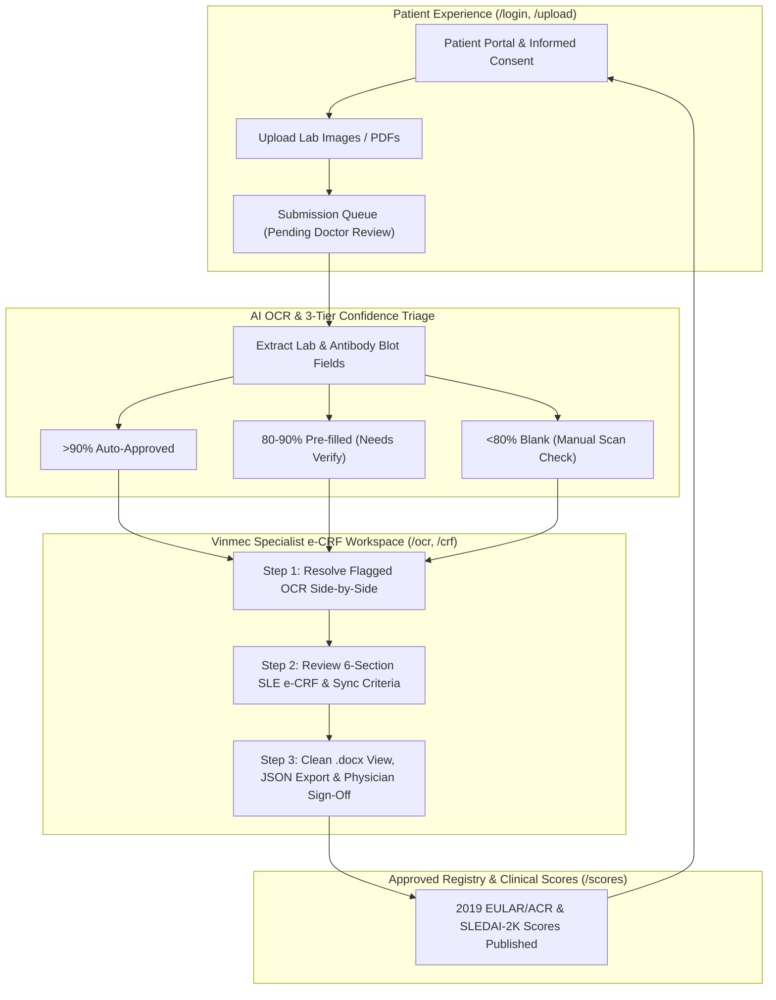

# Lupiva: Intelligent SLE Clinical Registry & Patient Companion Platform

[](https://vinmec.com)
[]()
[]()
[-orange.svg)]()

> **Lupiva** is a clinical registry and patient companion web application tailored for **Systemic Lupus Erythematosus (SLE)**. Built for the **Vinmec Innovation Challenge 2026**, Lupiva bridges patient document submission, Physician-in-the-Loop (HITL) lab report OCR, standardized electronic Case Report Forms (**e-CRF**), and automated **2019 EULAR/ACR** & **SLEDAI-2K** clinical scoring.

---

## Executive Summary

Systemic Lupus Erythematosus (SLE) is a complex, chronic autoimmune disorder requiring rigorous longitudinal monitoring across immunology, renal, hematologic, and multi-organ domains. **Lupiva** streamlines lupus care and clinical research through:

1. **Patient Document Upload Portal (`/upload`)**: Enables patients to submit scanned lab reports or PDFs, track review status (`Pending Doctor Review` → `Approved`), and view verified SLE scores.
2. **Physician-in-the-Loop (HITL) OCR & Standardized SLE e-CRF (`/ocr` & `/crf`)**: Side-by-side document grounding with **3-tier AI confidence triage** (`>90%` auto-approved, `80–90%` pre-filled for verification, `<80%` left blank for manual entry against the original scan) across a comprehensive 6-section SLE Case Report Form.
3. **Automated SLE Scoring (`/scores`)**: Computes **2019 EULAR/ACR Classification Criteria** (ANA `>= 1:80` entry criterion and weighted domain scoring) and **SLEDAI-2K Disease Activity** directly from verified OCR and clinical findings.

---

## Core Features

### 1. Patient Upload Portal & Doctor Submissions Dashboard (`/upload`)
* **Patient / Guest Screen**: Drag-and-drop multi-file image and PDF uploader alongside a one-click sample hospital dossier loader. When signed in as a patient, **"Your submissions"** displays only that patient's own 3-step review status (`Pending Doctor Review` → `Approved`); when logged out, submission history is hidden.
* **Doctor Screen (`specialist`)**: Hides the upload form and displays all submitted patient dossiers with demographics/BMI, attached files, clinical/organ involvement tags, current medications, 3-tier AI OCR triage counts, EULAR/ACR 2019 & SLEDAI-2K score previews, and direct handoff to `/ocr` and `/scores`.

### 2. HITL Document OCR & 6-Section SLE e-CRF (`/ocr`, `/crf` — Specialist Only)
* **Split-Screen Source Grounding**: Displays patient-uploaded documents or multi-panel hospital scan sheets (`Immunology`, `Renal`, `Hematology`, `Infectious`, `PFT`) alongside structured e-CRF fields with simulated OCR laser scanning and field-level highlighting.
* **3-Tier Confidence Triage**:
  * **`>90%` (`auto_approved`)**: High-confidence values automatically populated and approved.
  * **`80–90%` (`needs_verify`)**: Pre-filled values flagged in amber for explicit physician confirmation or inline editing.
  * **`<80%` (`manual_required`)**: Intentionally left blank so clinicians inspect the original scan before entering the value—preventing silent OCR hallucinations.
* **Guided 3-Step Doctor Workflow**:
  1. **Step 1 — Resolve Flagged OCR**: Triage `<80%` manual-entry and `80–90%` verification items across lab fields and antibody blot panels (`ANA Profile 23`, `Myositis 16`).
  2. **Step 2 — Review Full CRF & Scores**: Inspect and edit all 6 e-CRF sections (`Demographics`, `Medical History`, `Organs Damage`, `Immunology`, `2019 EULAR/ACR`, `SLEDAI-2K`), including auto-calculated BMI, renal biopsy classes, and HRCT ILD patterns.
  3. **Step 3 — Sign-Off, Clean `.docx` View & Export**: Toggle a print-ready `.docx`-formatted Case Report Form (`DocxCrfView`), export structured JSON (`<studyId>-sle-crf.json`), and sign off to publish verified scores.

### 3. SLE Classification & Disease Activity Scoring (`/scores` — Specialist Only)
* **2019 EULAR/ACR & SLEDAI-2K Tables**: Displays domain-weighted EULAR/ACR scores (10-point classification threshold with ANA entry gate) and SLEDAI-2K activity weights with OCR biomarker hint badges.
* **One-Click Sync & Print**: Specialists can re-sync criteria from verified OCR lab results (`Sync from Verified OCR`) and print standardized clinical reports.

### 4. Role-Aware Access & Bilingual Localization (`/login`, Global Navbar)
* **Role Switching with Informed Consent**: Supports switching between **Vinmec Clinical Specialist** (`Dr. Nguyen Minh, MD, PhD`) and **SLE Registry Patient** (`Tran Thi Mai`) with one-click demo autofill and an informed consent check for patient registry contributions.
* **Bilingual EN / VI UI**: Persistent English and Vietnamese (`EN` / `VI`) toggle in the global navbar, plus an interactive **UI Button Action Guide** modal documenting interactive controls.

---

## System Workflow & Architecture



---

## Tech Stack & Local Development

* **Framework**: Next.js 16 (App Router) & React 19
* **Language**: TypeScript 5 (`strict: true`)
* **Styling**: Tailwind CSS v4 (`@import "tailwindcss";`)
* **Fonts**: `Plus Jakarta Sans` & `JetBrains Mono` (with `tabular-nums` for quantitative lab values)

### Getting Started

```bash
# 1. Install dependencies
npm install

# 2. Start the development server (http://localhost:3000)
npm run dev

# 3. Run production build & TypeScript/route checks
npm run build

# 4. Run ESLint
npm run lint
```

> **Note**: All patient records, lab reports, and OCR extraction passes in this prototype run deterministically on typed client-side mock datasets (`src/data/crfData.ts`, `src/data/mockData.ts`) so clinical evaluators can test the end-to-end workflow without an external backend.

---

## Roadmap & Milestones (Vinmec Innovation Challenge 2026)

| Phase | Date | Milestone / Deliverable | Status |
| :--- | :--- | :--- | :---: |
| **Week 2** | **Nov 10, 2026** | Complete Clinical CRF schema & Lab Result Extraction engine | ✅ Implemented in Prototype |
| | **Nov 11, 2026** | **Abstract Submission Deadline** - *Vinmec Innovation Challenge* | ✅ Submitted |
| **Week 3** | **Nov 18, 2026** | SLE Registry Web Prototype Completion | 🔄 Active Refinement |
| | **Nov 22, 2026** | **Pitch Deck / Slide Submission Deadline** | 🎯 Upcoming |
| | *TBD* | **ROI & Clinical Feasibility Review** with the Practical AI Evaluation Board | 📅 Pending |
| **Week 4** | **Nov 25, 2026** | SLE Registry Platform V1.0 Finalized | 📅 Scheduled |
| | **Nov 28–29, 2026** | **Final Onsite Project Pitch & Defense** at Vinmec Innovation Challenge | 🏆 Final |

---

## Strategic Vision & Long-Term Clinical Impact

* **High-Quality Real-World Evidence (RWE)**: Transforms unstructured hospital visits into a structured, longitudinal SLE cohort dataset for clinical research and drug response monitoring.
* **Scalable Care Model**: Integrates Vinmec's Clinical Immunology & Allergy department with community patients, expanding specialist reach while lowering emergency flare-up admissions.
* **Defensible ROI**: Reduces clinical data entry burden via confidence-triaged OCR parsing while preserving strict physician oversight and patient engagement.

---

## Medical Disclaimer & Data Ethics

> **Medical Disclaimer:** *Lupiva is a clinical support and educational tool. The AI component operates strictly under physician supervision and is NOT a substitute for emergency care or independent diagnostic judgment.*  
> **Ethics & Privacy:** *All patient contributions adhere strictly to international Informed Consent standards, de-identification protocols, and patient confidentiality policies (HIPAA/GDPR principles).*

---

## Contributors & Collaboration

Developed with guidance and clinical insights from specialists in **Clinical Immunology & Allergy**, submitted for the **Vinmec Innovation Challenge 2026**.

* Repository: [https://github.com/dlvanh/Lupiva](https://github.com/dlvanh/Lupiva)
* Members: [@dlvanh](https://github.com/dlvanh), [@phamkien_1](https://github.com/pvksssss), [@VietHoang04-sys](https://github.com/VietHoang04-sys)
