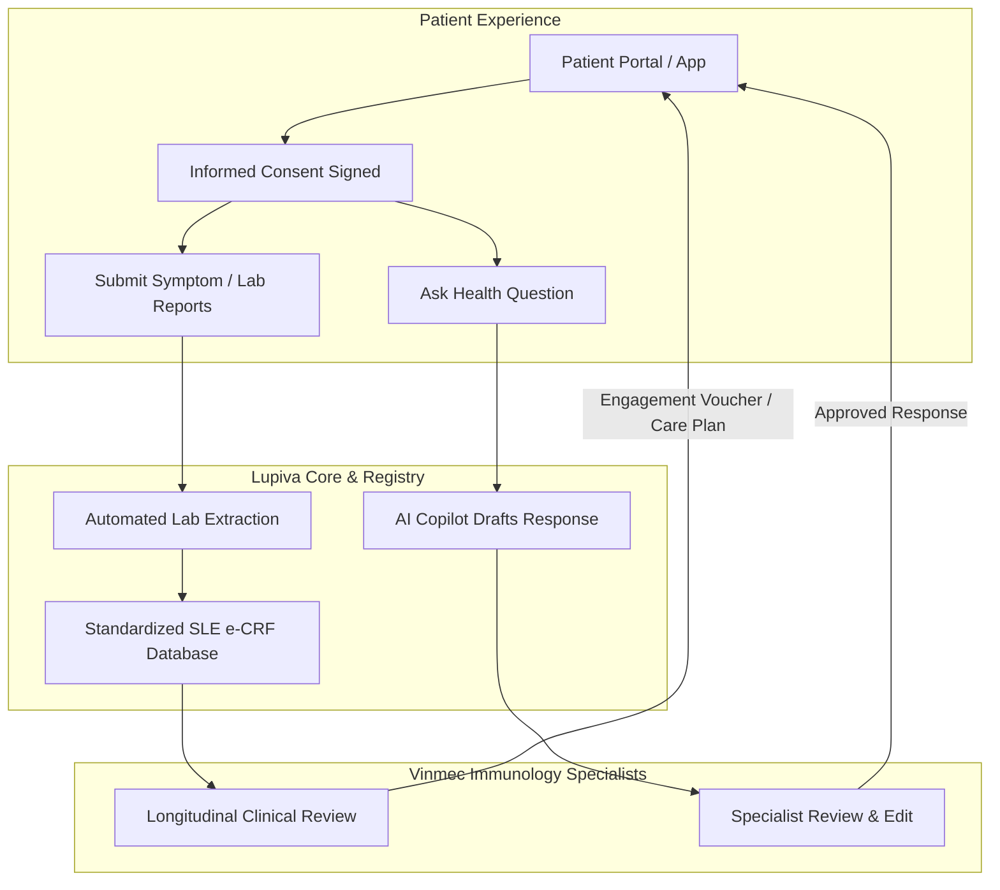

# 🦋 Lupiva: Intelligent SLE Registry & Patient Companion Platform

[-orange.svg)]()

> **Lupiva** is a next-generation clinical registry and patient care platform tailored for **Systemic Lupus Erythematosus (SLE)**. Built for the **Vinmec Innovation Challenge**, Lupiva bridges clinical data standardization, expert medical consultations, and physician-supervised AI to elevate chronic autoimmune disease management.

---

## 📌 Executive Summary

Systemic Lupus Erythematosus (SLE) is a complex, chronic autoimmune disorder requiring rigorous, longitudinal monitoring and multi-specialty care. **Lupiva** resolves critical bottlenecks in lupus management by providing:
1. **Standardized Clinical Research Registry (e-CRF)** with automated lab test extraction.
2. **Physician-in-the-Loop (HITL) AI Assistant** ensuring clinically safe, validated medical advice.
3. **Patient Engagement & Care Incentives** connecting consenting patients directly to Vinmec Clinical Immunology & Allergy specialists.

---

## 🌟 Core Features

### 1. 📊 Standardized SLE Clinical Registry (e-CRF)
* **Standardized Case Report Forms (CRF):** Structured clinical data capture designed to align with international rheumatology and immunology registry standards.
* **Automated Lab Data Extraction:** Ingests and parses complex immunological and clinical lab reports (e.g., ANA, anti-dsDNA, C3/C4 complement levels, urinalysis, hematology) directly into structured patient profiles.

### 2. 🩺 Physician-in-the-Loop (HITL) AI Assistant
* **Patient Query Pre-Screening:** AI provides instant preliminary health education, symptom triage, and answers based on validated clinical guidelines.
* **Mandatory Specialist Verification:** No AI response is dispatched to patients without direct review, annotation, and approval from clinical specialists—ensuring zero hallucinations and strict medical safety.

### 3. 🤝 Direct Specialist Q&A & Patient Engagement
* **Direct Doctor Portal:** Secure, asynchronous communication channel between lupus patients and Vinmec Clinical Immunology specialists.
* **Informed Consent & Incentive Mechanism:** Patients who consent to contribute de-identified registry data receive personalized healthcare incentives (e.g., consultation vouchers for Vinmec Clinical Immunology & Allergy clinic), fostering sustained user engagement.

---

## 🔄 System Workflow & Architecture

---

## 📅 Roadmap & Milestones (Vinmec Innovation Challenge 2026)

| Phase | Date | Milestone / Deliverable | Status |
| :--- | :--- | :--- | :---: |
| **Week 2** | **Nov 10, 2026** | Complete Clinical CRF schema & Lab Result Extraction engine | ⏳ In Progress |
| | **Nov 11, 2026** | **Abstract Submission Deadline** - *Vinmec Innovation Challenge* | 🎯 Upcoming |
| **Week 3** | **Nov 18, 2026** | SLE Registry Web Prototype Completion | 📅 Scheduled |
| | **Nov 22, 2026** | **Pitch Deck / Slide Submission Deadline** | 🎯 Upcoming |
| | *TBD* | **ROI & Clinical Feasibility Review** with the Practical AI Evaluation Board | 📅 Pending |
| **Week 4** | **Nov 25, 2026** | SLE Registry Platform V1.0 Finalized | 📅 Scheduled |
| | **Nov 28–29, 2026** | **Final Onsite Project Pitch & Defense** at Vinmec Innovation Challenge | 🏆 Final |

---

## 🔮 Strategic Vision & Long-Term Clinical Impact

* **High-Quality Real-World Evidence (RWE):** Transforms unstructured hospital visits into a structured, longitudinal SLE cohort dataset for clinical research and drug response monitoring.
* **Scalable Care Model:** Integrates Vinmec’s Clinical Immunology & Allergy department with community patients, expanding the hospital's reach while lowering emergency flare-up admissions.
* **Defensible ROI:** Reduces clinical data entry burden via automated lab parsing; boosts outpatient retention through institutional vouchers and proactive digital check-ins.

---

## 🛡️ Medical Disclaimer & Data Ethics

> **Medical Disclaimer:** *Lupiva is a clinical support and educational tool. The AI component operates strictly under physician supervision and is NOT a substitute for emergency care or independent diagnostic judgment.*  
> **Ethics & Privacy:** *All patient contributions adhere strictly to international Informed Consent standards, de-identification protocols, and patient confidentiality policies (HIPAA/GDPR principles).*

---

## 👥 Contributors & Collaboration

Developed with guidance and clinical insights from specialists in **Clinical Immunology & Allergy**, submitted for the **Vinmec Innovation Challenge 2026**.

* Repository: [https://github.com/dlvanh/Lupiva](https://github.com/dlvanh/Lupiva)
* Project Lead: [@dlvanh](https://github.com/dlvanh)

## Local OCR and registry implementation

The current implementation includes offline OCR, structured candidate pools, immutable SQLite revisions, and local source review for observations, metadata, and specimen forms. See [DEVELOPMENT.md](DEVELOPMENT.md) for setup, tests, commands, and current implementation limits. Product features and milestones above describe the broader roadmap.
