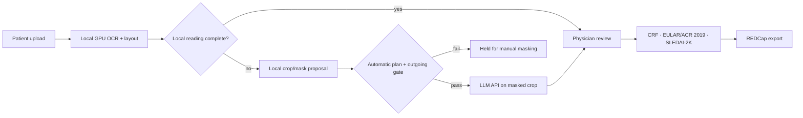

# Lupiva: patient-powered SLE registry

Lupiva is a research registry prototype for **systemic lupus erythematosus (SLE)** in Vietnam. Patients upload photos of their own lab and imaging reports; local OCR and an LLM turn them into a standardised case report form (CRF); a specialist verifies every value against its source before it enters the registry.

> Setup and run (Python backend + Next.js web): [RUNNING.md](RUNNING.md) · Development and tests: [DEVELOPMENT.md](DEVELOPMENT.md) · Data handling: [PRIVACY.md](PRIVACY.md)

**Status:** research prototype. All images and records in this repository are synthetic. Not a medical device.

## What it does

- **Patient portal** (`web/`): registration with electronic consent, photo upload with retries on weak networks, submission status.
- **Document-to-CRF extraction** (`ocr_pool/`, `registry_review/`): local OCR (SenOCR-Vi, PP-DocLayout) with line coordinates, automatic crop/mask of identifiers, LLM extraction mapped to CRF fields, provenance down to the page region.
- **Physician review**: each value is shown next to its source image; nothing is written to the CRF until a specialist approves it.
- **Registry and export**: standardised CRF, EULAR/ACR 2019 classification and SLEDAI-2K inputs, REDCap-compatible export of approved values only.

## Extraction flows

| Flow | Role | What leaves the machine |
|---|---|---|
| **C. Hybrid: local OCR first, LLM only when needed** | **Target design** (`scripts/run_hybrid_pool.py`) | Nothing for pages local OCR settles; masked page crops for the rest, after an outgoing gate |
| B. OCR → crop/mask identifiers → LLM | Experimental baseline; current default intake path (`scripts/run_llm_pool.py`) | Masked page crops + local OCR lines |
| A. Direct LLM | Experimental, synthetic images only (`LUPIVA_PROTOTYPE_DIRECT_LLM=1`) | Whole unmasked image |

Flow C routes each page: complete, unflagged local readings are kept without any API call; other pages get a locally proposed crop/mask plan and go through flow B; pages without an automatic plan are held for manual review and never sent. `routing.json` records the route, reasons and timings for every page. A and B are kept for comparison.

## Repository layout

| Path | Contents |
|---|---|
| `web/` | Next.js app: patient portal, physician dashboard, review and CRF pages |
| `ocr_pool/` | OCR, privacy cropping/masking, LLM extraction, hybrid router |
| `registry_review/` | Review server, intake queue, privacy proposals |
| `registry_pool/`, `registry_export/`, `form_pool/` | Candidate pool, registry store, export |
| `scripts/` | Runners for each flow, setup and deploy helpers |
| `tests/`, `web/tests/` | Python and web test suites (synthetic data only) |
| `examples/pool-tests/` | Synthetic lab tables used by the tests |

## Disclaimer

Lupiva supports research data collection under physician supervision. It does not give diagnoses or treatment advice, and AI output is never used without specialist review.

## Contributors

Clinical guidance from the Vinmec-VinUni Institute of Immunology and the Centre of Allergy and Clinical Immunology, Vinmec Times City. Repository: [github.com/dlvanh/Lupiva](https://github.com/dlvanh/Lupiva).
